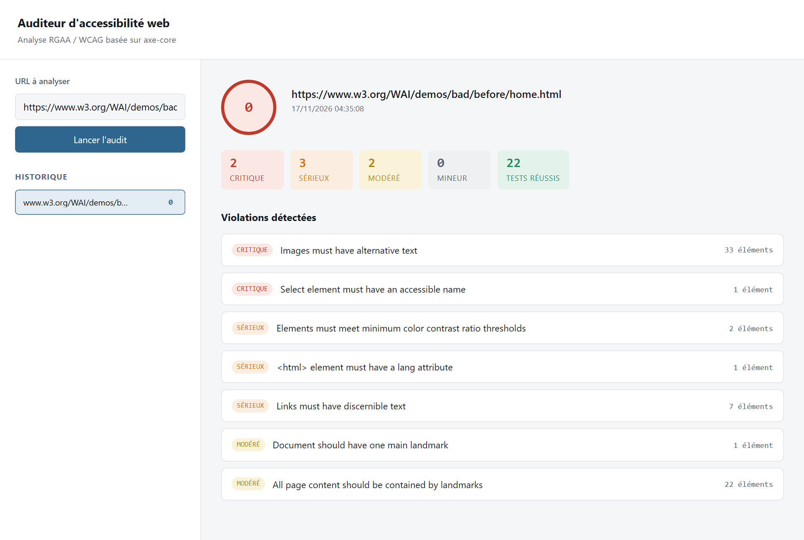

# Auditeur d'accessibilité web (RGAA)

[](https://github.com/oussamaa29/a11y-auditor/actions/workflows/ci.yml)

Scanne une URL et génère un rapport d'accessibilité complet : score, violations classées par sévérité (critique, sérieux, modéré, mineur), éléments HTML concernés et lien vers la documentation de chaque règle. Basé sur [axe-core](https://github.com/dequelabs/axe-core), le moteur de règles utilisé par la plupart des outils d'audit d'accessibilité du marché.



## Pourquoi ce projet

Le RGAA (référentiel d'accessibilité français) impose des obligations d'accessibilité, notamment pour les sites publics. Ce projet automatise le premier niveau de diagnostic : plutôt que d'auditer une page à la main, on obtient en quelques secondes un score et une liste priorisée des problèmes à corriger.

## Stack

| Couche | Techno |
|--------|--------|
| Frontend | React + TypeScript (Vite) |
| Backend | FastAPI (Python) |
| Moteur de scan | Selenium (Chrome headless) + axe-core |
| Base de données | SQLite (historique des scans) |

## Lancer le projet en local

### Backend

```bash
cd backend
python -m venv venv
venv/Scripts/activate        # Windows
pip install -r requirements-dev.txt   # dépendances + outils de test
cp .env.example .env
uvicorn main:app --reload --port 8020
```

Nécessite Google Chrome installé (le scan pilote Chrome directement via Selenium, sans navigateur embarqué séparé).

### Frontend

```bash
cd frontend
npm install
cp .env.example .env
npm run dev
```

Ouvrir `http://localhost:5174`.

## Fonctionnalités

- Scan d'une URL : score sur 100, compteurs par sévérité, nombre de tests réussis
- Détail de chaque violation : description, règle enfreinte, éléments HTML concernés, lien vers la documentation Deque
- Historique de tous les scans effectués, consultable à tout moment
- Gestion des erreurs (URL invalide, page inaccessible, timeout)

## Sécurité : un scanner qui ouvre des URL côté serveur

Le backend charge dans un vrai navigateur l'URL que lui donne l'utilisateur, puis renvoie des extraits du HTML de la page. Sans protection, c'est une **SSRF** : on pourrait lui faire lire `http://localhost:8000/admin`, un intranet, ou `http://169.254.169.254/`, qui expose les identifiants des machines cloud.

| Risque | Protection |
|---|---|
| URL vers une adresse interne | L'hôte est résolu avant le scan. Si **une seule** des adresses renvoyées n'est pas publique (privée, loopback, link-local, CGNAT, multicast, IPv4 encapsulée dans de l'IPv6…), le scan est refusé (400) et Chrome n'est pas lancé |
| DNS rebinding (le DNS répond une adresse publique à la vérification, puis interne au chargement) | Chrome est lancé avec `--host-resolver-rules` : l'hôte est épinglé sur l'adresse déjà validée |
| Redirection vers un hôte interne | L'adresse finale est revérifiée avant de lire la page ; si elle est interne, rien n'est renvoyé ni enregistré |
| Schémas dangereux (`file://`, `javascript:`…) | Seuls `http` et `https` sont acceptés |
| Rafale de requêtes (chaque scan ouvre un Chrome) | Au plus `MAX_CONCURRENT_SCANS` scans simultanés (2 par défaut), les suivants reçoivent un 503 |

Limite connue : les ressources secondaires d'une page publique (images, scripts) sont chargées par Chrome sans ce contrôle. En production, le scanner doit tourner sur une machine dont le trafic sortant vers le réseau interne est filtré.

## Tests

```bash
cd backend
pytest
```

42 tests : calcul du score, validation des URL (plages d'adresses internes, résolveur DNS simulé, IP littérales), API (création, historique paginé, suppression, erreurs, refus des URL internes, limite de concurrence). Chrome n'est pas lancé pendant les tests. La CI GitHub Actions exécute les tests, le lint et le build du frontend.

## Structure

```
a11y-auditor/
├── backend/
│   ├── main.py          # Routes FastAPI (scans CRUD)
│   ├── scanner.py       # Pilotage Selenium + injection axe-core + scoring
│   ├── url_guard.py     # Protection SSRF (validation et résolution des URL)
│   ├── tests/           # Tests pytest
│   ├── models.py           # Modèle SQLAlchemy Scan
│   ├── schemas.py
│   ├── database.py
│   ├── config.py
│   └── vendor/axe.min.js  # Moteur axe-core vendorisé localement
└── frontend/
    └── src/
        ├── App.tsx          # Formulaire, historique, résultats
        ├── api.ts
        ├── types.ts
        └── components/
            └── ViolationCard.tsx
```

## Calcul du score

Le score part de 100 et retire des points par violation détectée, pondérés par sévérité (critique -10, sérieux -6, modéré -3, mineur -1), plafonné à 5 occurrences par règle pour qu'un problème répété massivement ne fasse pas chuter le score de façon disproportionnée.

## Licence

MIT
